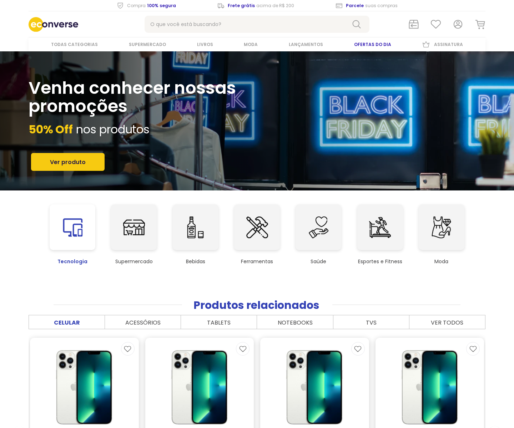

# Econverse — teste front-end

Implementação responsiva do protótipo do [teste para Desenvolvedor Front-End Jr.](https://www.figma.com/proto/rWnzPeoxgynuNPsJjV0VmV/Teste-Front-End-Jr?node-id=1-1248&scaling=min-zoom&page-id=0%3A1&starting-point-node-id=1%3A1248), feita com React, TypeScript e Sass.



**Demonstração online:** [Acessar o site](https://yuurih44.github.io/teste-front-end/)

O GitHub Pages publica a versão atual automaticamente a cada atualização da branch `main`. Na primeira publicação, ative **Settings → Pages → Build and deployment → Source: GitHub Actions** no repositório e execute **Actions → Publicar no GitHub Pages → Run workflow**.

## Executar o teste

```sh
npm ci
npm run dev
```

O catálogo oficial da Econverse é carregado por padrão. Abra a URL informada pelo Vite, normalmente:

```text
http://localhost:5173/
```

Para abrir diretamente, use `?catalog=assessment`; o parâmetro é opcional porque esse já é o modo padrão. A página consulta o JSON da Econverse pelo proxy `/api/products`. O catálogo local de iPhones continua disponível em `?catalog=real`. A captura de tela e os departamentos adicionais usam dados locais.

## Requisitos

No Windows, você só precisa instalar o **Node.js** e o **npm** se ainda não estiverem no computador. Se já tiver uma versão compatível do Node.js e o npm, pule a instalação e vá direto ao passo 3.

1. Abra o **Prompt de Comando (cmd)** e confira se já estão instalados:

   ```bat
   node -v
   npm -v
   ```

   O projeto aceita Node.js 22.13 ou superior da linha 22, Node.js 24 ou versões a partir da 26.

2. Se não estiverem instalados, instale o **Node.js 22**, que já inclui o **npm**:

   ```bat
   winget install --id OpenJS.NodeJS.22 --exact --source winget
   ```

   Se sua versão do Node.js não for compatível, atualize-a antes de continuar. Depois da instalação, feche e abra novamente o Prompt de Comando e confira com `node -v` e `npm -v`.

   Se o comando `winget` não estiver disponível, use o [instalador oficial do Node.js](https://nodejs.org/en/download).

3. Na pasta do projeto, instale as dependências e inicie a aplicação:

   ```bat
   npm ci
   npm run dev
   ```

## Scripts

| Comando                | Uso                                                 |
| ---------------------- | --------------------------------------------------- |
| `npm run dev`          | Inicia o servidor de desenvolvimento.               |
| `npm run check`        | Executa lint, verificação de tipos, testes e build. |
| `npm run test:e2e`     | Compila e executa os testes no Playwright.          |
| `npm run format:check` | Confere a formatação.                               |
| `npm run build`        | Gera a versão de produção em `dist/`.               |
| `npm start`            | Serve a aplicação compilada e o proxy da API.       |

Para rodar os testes de navegador pela primeira vez, instale o Chromium com `npx playwright install chromium`.

## Catálogos

A página sem parâmetros consome o JSON oficial da Econverse. Para consultar os dez modelos de iPhone com nomes, preços e fotos por variante, abra `?catalog=real`. Os SKUs, a origem e a data da consulta estão em [`reference/precos-fontes.json`](reference/precos-fontes.json); a aplicação usa a cópia em `public/data/products-real.json`.

O endpoint consultado é `https://app.econverse.com.br/teste-front-end/junior/tecnologia/lista-produtos/produtos.json`. Como a API não habilita CORS para o navegador, `/api/products` encaminha a solicitação. O proxy está configurado no Vite e no servidor Node de produção; a aplicação precisa ser servida com Node ou um proxy equivalente.

Na demonstração online, o catálogo oficial é capturado durante a publicação e servido em `/api/products`; ele é atualizado a cada nova publicação.

Os outros departamentos e as categorias adicionais de Tecnologia usam dados locais. Seus preços são exemplos e estão identificados na interface. Carrinho, favoritos, conta, assinatura e newsletter funcionam localmente.

## Extras demonstrativos

Além dos requisitos do teste, optei por incluir favoritos, carrinho, conta, assinatura e navegação por departamentos. Também adicionei produtos de outras categorias para tornar a experiência mais realista, sem me limitar aos celulares e mantendo o mesmo layout do protótipo. Achei que essas melhorias deixariam a loja mais completa e eficiente.

## Projeto

```text
src/
  app/                    Inicialização e composição da página
  components/             Layout, seções e elementos compartilhados
  features/
    account/               Perfil e preferências de assinatura
    catalog/               Dados, API, busca e apresentação de produtos
    shopping/              Carrinho, favoritos e persistência
  styles/                 Tokens, estilos e regras responsivas
  utils/                  Formatação e navegação
e2e/                       Testes de navegador
public/                     Imagens, fontes e dados servidos pela aplicação
docs/                       Arquitetura, créditos e capturas
reference/                  Enunciado e registros usados no projeto
```

Os módulos de cada funcionalidade mantêm juntos seus componentes, regras e testes. [`docs/ARCHITECTURE.md`](docs/ARCHITECTURE.md) descreve o fluxo da aplicação. O enunciado e o roteiro de validação ficam em `reference/`.

## Verificação

`npm run check` cobre lint, TypeScript, testes unitários e build. `npm run test:e2e` percorre os fluxos de busca, navegação, carrinho, favoritos e diálogos no navegador. O workflow em `.github/workflows/quality.yml` executa as verificações em pushes e pull requests.

As imagens e fontes locais têm suas origens registradas em [`docs/IMAGE-CREDITS.md`](docs/IMAGE-CREDITS.md). A licença da Poppins está em `public/fonts/OFL.txt`.
